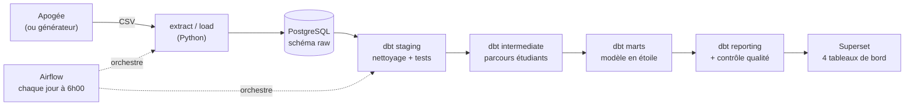

# Plateforme BI — Pilotage des inscriptions universitaires (Apogée)

Pipeline ELT complet et tableaux de bord pour le suivi des inscriptions d'une université
à partir des données du système d'information **Apogée** : effectifs, profils des étudiants,
parcours (passage, redoublement, abandon), inscriptions pédagogiques et qualité des données.

> Le projet fonctionne aujourd'hui avec des **données simulées réalistes**. Il est conçu pour
> basculer sur les **exports Apogée réels** sans modification du code (voir
> [Passage aux données réelles](#passage-aux-données-réelles)).

---

## Architecture



| Composant | Technologie | Rôle |
|---|---|---|
| Entrepôt de données | PostgreSQL 16 | Stockage de toutes les couches (raw → reporting) |
| Orchestration | Apache Airflow 2.9 | Exécution quotidienne et supervision du pipeline |
| Transformation | dbt 1.8 | Nettoyage, modélisation, tests de qualité, documentation |
| Visualisation | Apache Superset | Tableaux de bord interactifs |
| Conteneurisation | Docker Compose | Déploiement reproductible de l'ensemble |

## Données sources

Trois tables du référentiel Apogée :

| Table | Contenu | Grain |
|---|---|---|
| `INDIVIDU` | Profil de l'étudiant (identité, naissance, nationalité, contact) | un étudiant |
| `INS_ADM_ETP` | Inscriptions administratives annuelles | étudiant × année × composante |
| `IND_CONTRAT_ELP` | Inscriptions pédagogiques aux modules | étudiant × année × étape × module |

## Structure du projet

```
.
├── airflow/dags/pipeline_apogee_inscriptions.py   # DAG : ingestion → dbt → contrôle qualité
├── src/
│   ├── config.py           # connexion à la base (variables d'environnement)
│   ├── referentiel.py      # nomenclatures + export des seeds dbt
│   ├── extract.py          # générateur de données Apogée simulées
│   ├── load.py             # chargement atomique (COPY) dans le schéma raw
│   └── generate_dico.py    # dictionnaire de données Excel automatique
├── sql/init.sql            # schéma raw + journal des chargements
├── dbt_project/
│   ├── seeds/              # nomenclatures (libellés) + catalogue des contrôles qualité
│   ├── macros/             # nettoyage défensif, nommage des schémas, droits BI
│   ├── models/
│   │   ├── staging/        # nettoyage, typage, dédoublonnage
│   │   ├── intermediate/   # étape principale, parcours annuel
│   │   ├── marts/          # dimensions et faits
│   │   └── reporting/      # tables pour Superset + qualité des données
│   └── tests/              # tests génériques et règles métier
├── superset/
│   ├── superset_config.py  # configuration (français, formats numériques)
│   └── exports/            # sauvegarde des tableaux de bord (ZIP)
├── docs/                   # dictionnaire de données + documentation dbt
├── docker/                 # initialisation PostgreSQL
├── Dockerfile              # image Airflow + dbt
└── docker-compose.yml
```

## Modèle de données (dbt)

| Couche | Schéma | Contenu |
|---|---|---|
| Données brutes | `raw` | Exports chargés tels quels (colonnes texte), journal des chargements |
| Référentiel | `referentiel` | Libellés des composantes, étapes, modules, pays, provinces, états |
| Staging | `staging` | Données nettoyées, typées, dédoublonnées |
| Intermédiaire | `intermediate` | Étape principale annuelle, parcours (passage, redoublement, sortie) |
| Marts | `marts` | 5 dimensions + 2 tables de faits (modèle en étoile) |
| Reporting | `reporting` | Tables prêtes pour Superset, indicateurs, qualité des données |

**Qualité** : plus de 100 tests dbt (unicité, intégrité référentielle, valeurs acceptées,
règles métier) et 11 contrôles de qualité métier publiés dans un tableau de bord.
Un test bloquant en échec interrompt le pipeline : les tableaux de bord conservent la
dernière version valide.

## Tableaux de bord

| Tableau de bord | Question à laquelle il répond |
|---|---|
| Vue d'ensemble des inscriptions | Combien d'étudiants, où, et quel est leur profil ? |
| Parcours et réussite | Que deviennent les étudiants d'une année sur l'autre ? |
| Inscriptions pédagogiques | Quels modules, quand et comment sont-ils saisis ? |
| Qualité des données | Peut-on se fier aux chiffres ? Quelles anomalies corriger dans Apogée ? |

## Installation

### Prérequis
- Docker Desktop (avec WSL 2 sous Windows)
- Git

### Démarrage

```bash
git clone <url-du-depot> && cd code212
cp .env.example .env              # puis renseigner les mots de passe (sans espaces ni caractères spéciaux)
chmod -R a+rwX data docs
docker compose up -d --build
docker compose ps                  # attendre que les services soient "healthy"
```

| Service | Adresse |
|---|---|
| Airflow | http://localhost:8080 (identifiants `AIRFLOW_ADMIN_*` du `.env`) |
| Superset | http://localhost:8088 (`admin` / `admin` à la première connexion) |

### Premier lancement

1. **Pipeline** : dans Airflow, activer puis déclencher `pipeline_apogee_inscriptions`.
2. **Mot de passe Superset** :
   `docker exec -it superset_bi superset fab reset-password --username admin --password <nouveau>`
3. **Tableaux de bord** : Superset → *Dashboards* → *Import* → choisir le ZIP de
   `superset/exports/`, puis saisir le mot de passe `BI_PASSWORD` de la connexion.

## Utilisation

Le pipeline s'exécute automatiquement **chaque jour à 6h00** (heure du Maroc).

| Commande | Usage |
|---|---|
| `docker exec -it airflow_scheduler dbt build` | Reconstruire et tester toutes les couches |
| `docker exec -it airflow_scheduler dbt source freshness` | Vérifier la fraîcheur des données |
| `docker exec -it airflow_scheduler python /opt/airflow/src/generate_dico.py` | Régénérer le dictionnaire de données |
| `docker exec -it airflow_scheduler dbt docs generate --static` | Régénérer la documentation dbt |
| `docker compose stop` / `docker compose start` | Arrêter / redémarrer la plateforme |

> ⚠️ Ne jamais utiliser `docker compose down -v` sans avoir exporté les tableaux de bord :
> cette commande supprime la base de données.

## Passage aux données réelles

1. Déposer les exports Apogée dans `data/raw/` sous les noms `individu.csv`,
   `ins_adm_etp.csv` et `ind_contrat_elp.csv` (colonnes identiques au référentiel Apogée).
2. Dans `.env` : `ETL_SOURCE=apogee` (et, si besoin, `CSV_ENCODING=latin-1`, `CSV_DELIMITER=;`).
3. Remplacer les nomenclatures de `dbt_project/seeds/` (`ref_composante.csv`, `ref_etape.csv`,
   `ref_element_pedagogique.csv`, `ref_pays.csv`, `ref_departement_naissance.csv`,
   `ref_etat_iae.csv`) par celles de l'université.
4. Adapter si nécessaire les variables métier de `dbt_project/dbt_project.yml`
   (`utilisateurs_batch`, `mois_reference_age`).
5. Redémarrer (`docker compose up -d`) et déclencher le DAG.

La génération est alors ignorée, `load.py` valide la structure des fichiers avant tout
chargement, et les codes absents du référentiel restent visibles avec la mention
« (non référencé) » au lieu de disparaître des tableaux de bord.

## Sécurité et données personnelles

- Aucun mot de passe dans le code : tout est dans `.env` (exclu de Git).
- Superset se connecte avec le rôle **`bi_lecteur`**, en **lecture seule** et limité au schéma
  `reporting` : les données brutes (emails, INE) lui sont inaccessibles.
- L'email et le numéro INE ne figurent dans aucune table de reporting
  (protection des données personnelles — loi 09-08).

## Documentation

- `docs/Dictionnaire_de_donnees.xlsx` : tables, colonnes, indicateurs et contrôles qualité.
- `docs/documentation_dbt.html` : documentation des modèles et graphe de lignage.

## Dépannage

| Problème | Solution |
|---|---|
| `bad interpreter: /bin/bash^M` | Fins de ligne Windows : enregistrer les fichiers en **LF** (VS Code : `files.eol = \n`) |
| `Permission denied` sur `data/` ou `docs/` | `chmod -R a+rwX data docs` |
| Superset : erreur 500 au premier démarrage | `docker compose restart superset` après la fin de `superset_init` |
| Connexion Superset refusée pour `bi_lecteur` | Réinitialiser : `ALTER ROLE bi_lecteur WITH PASSWORD '...'` (mot de passe sans caractères spéciaux) |
| DAG absent d'Airflow | `docker exec -it airflow_scheduler airflow dags list-import-errors` |